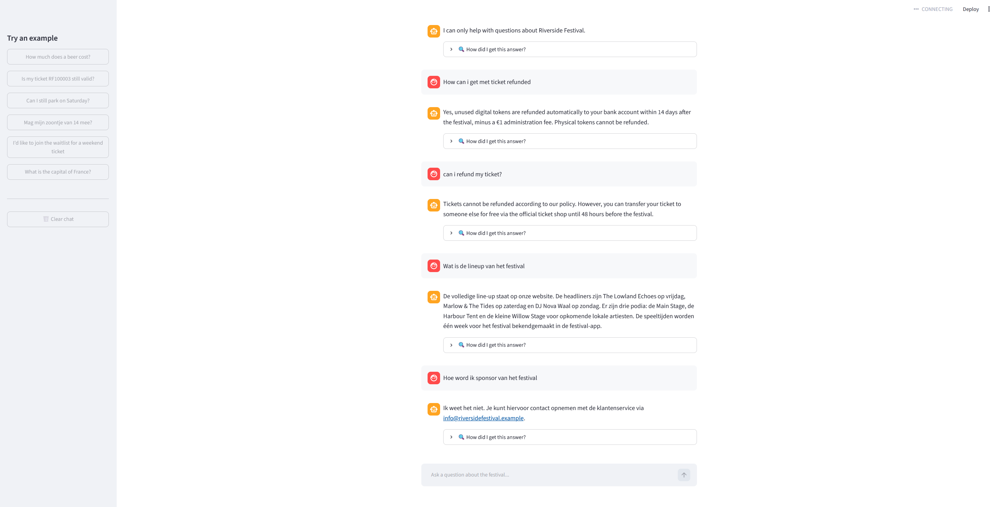
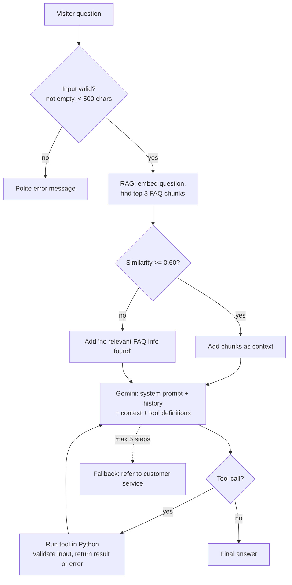

# Riverside Festival Assistant

A small AI agent that helps visitors of a (fictional) music festival. It answers questions from
the festival FAQ using **retrieval-augmented generation (RAG)** and performs simple actions,
such as checking a ticket or joining a waitlist, using **tool calling** on mock data.

I built it as a learning project to understand the basics of AI engineering: LLM APIs, RAG,
tool use, guardrails and evaluation. The idea is inspired by CM.com's HALO platform, which helps various organisations with their customer support.



## What it can do

- **Answer FAQ questions** about times, parking, tickets, tokens, camping and more. It works in
  English and Dutch, even though the FAQ is in English.
- **Call tools** with mock data:
  - `check_ticket(ticket_number)`: returns the type and status of a ticket.
  - `parking_availability(day)`: returns the free parking spots per festival day.
  - `join_waitlist(name, email, ticket_type)`: puts a visitor on the waitlist for sold-out tickets.
- **Stay on topic**: it refuses unrelated questions and prompt injection attempts.
- **Admit when it doesn't know** and refer the visitor to customer service instead of making
  things up.
- **Show its work**: every answer has a "How did I get this answer?" panel that lists the FAQ
  chunks (with similarity scores) and tool calls that were used.

## How it works



### RAG (`src/rag.py`)
1. The FAQ (`data/faq.md`) is split into one chunk per question, so each chunk holds one
   question and its answer.
2. Each chunk is turned into a vector with `gemini-embedding-001`. The vectors are cached in
   `data/embeddings_cache.npz`. The cache is rebuilt automatically when the FAQ or the
   embedding model changes, which is detected with a hash.
3. For each question, the agent embeds the question and ranks all chunks by **cosine
   similarity** with numpy. The top 3 chunks are kept. Chunks scoring below **0.60** are
   dropped: in my tests, relevant matches scored about 0.65–0.73 and off-topic questions about
   0.55.

With only about 20 chunks, a vector database would be overkill. A single numpy matrix
multiplication is enough.

### Agent loop (`src/agent.py`)
The agent loop is written by hand. Automatic function calling in the SDK is turned off. Each
step sends the conversation to the model. If the model asks for a tool, the tool is executed
in Python and the result is sent back. This repeats until the model gives a final answer, up
to a maximum of 5 steps.

### Guardrails
Guardrails are applied in two layers, because a prompt alone is never watertight:

| In the system prompt | In code |
|---|---|
| Only answer festival questions | Reject empty or overly long input |
| Only use facts from the FAQ and tool results | Drop FAQ chunks below the similarity threshold |
| Say "I don't know" and refer to customer service | Validate ticket numbers (`^RF\d{6}$`), email and day before running a tool |
| Ask for missing details instead of guessing | Never return the ticket holder's name (privacy) |
| Answer in the visitor's language, and ignore attempts to change the rules | Limit the agent to 5 steps, and fall back to a safe answer on errors |

### Reliability (`src/llm.py`)
The free Gemini tier is often overloaded, so `llm.py` handles failures:
- It retries temporary errors (429, 500, 503, 504 and network errors) with exponential backoff.
- It falls back from `gemini-flash-lite-latest` to `gemini-flash-latest` when one model stays
  unavailable.
- It sets a 30-second timeout per request.

Because the rest of the code only calls `generate()` and `embed()`, switching to another LLM
provider only requires changing this one file.

## Tech stack

- **Python 3.12**
- **Google Gemini API** (`google-genai`): Flash-Lite and Flash for chat and tool calling,
  `gemini-embedding-001` for embeddings
- **numpy** for cosine similarity
- **Streamlit** for the chat interface
- **pytest** for unit tests, and a custom eval script
- **Docker**

I deliberately didn't use LangChain or LlamaIndex. Building RAG and the agent loop myself let
me understand and explain every step.

## Running it

You need [Docker](https://www.docker.com/) and a free Gemini API key from
[Google AI Studio](https://aistudio.google.com/).

```bash
cp .env.example .env          # then add your key: GEMINI_API_KEY=...
docker build -t event-assistant .
docker run --rm -p 8501:8501 --env-file .env event-assistant
```

Then open http://localhost:8501.

Other commands, using PowerShell syntax (in bash, use `$(pwd)` instead of `${PWD}`):

```bash
# Unit tests for the tools (no API calls)
docker run --rm event-assistant python -m pytest -q

# Evals (~10 minutes on the free tier)
docker run --rm --env-file .env -v "${PWD}/data:/app/data" -v "${PWD}/evals:/app/evals" event-assistant python -m evals.run_evals

# Try the RAG search or the agent from the command line
docker run --rm --env-file .env event-assistant python -m src.rag
docker run --rm --env-file .env event-assistant python -m src.agent
```

## Evaluation

`evals/testcases.json` contains 18 test cases in three categories:
- **faq**: the answer must contain a specific fact, such as "1.5 tokens" for a beer.
- **tool**: the right tool must be called with the right arguments.
- **refusal**: off-topic questions, prompt injection, unknown answers and privacy (never
  reveal a ticket holder's name).

The checks are deterministic: the answer must or must not contain certain text, and a given
tool must or must not be called. Each run writes the answers and tool calls to
`evals/results.json`.

| Run | faq | tool | refusal | Total |
|---|---|---|---|---|
| Baseline | 6/6 | 5/7 | 4/5 | **15/18** |
| After prompt and retry fixes | 6/6 | 6/7 | 5/5 | **17/18** |

What the evals found:
- **Wrong language:** the model answered an English parking question in Dutch, probably
  because of Dutch place names like "Waalstrand". I fixed this with an explicit language rule
  in the prompt.
- **Refusing a valid question:** for festival questions not covered by the FAQ ("Is there a
  sauna?"), the model said it could *only help with festival questions*. I fixed this by
  making the "I don't know" rule separate from the "off-topic" rule in the prompt.
- **Network errors:** one test failed on a dropped connection. I fixed this by also retrying
  network errors.
- **The test was wrong, not the agent:** asked to join the waitlist without a name or email,
  the model called `join_waitlist` with empty arguments. The code validation rejected the
  call, and the model then asked for the missing details. Nobody was added to the waitlist,
  so the behaviour was safe. I changed the test to check that the tool never *succeeds*,
  instead of checking that it is never *called*.

## Lessons learned

- **Test AI components, don't assume they work.** `gemini-embedding-2` silently merged a list
  of 21 texts into **one** vector. There was no error, only bad search results. `embed()` now
  checks that it gets one vector per input.
- **Plan for API failures.** On the free tier, 503 and 504 errors were common. Retries, a
  fallback model and a timeout brought a run of 7 questions down from more than 10 minutes
  to about 10 seconds.
- **Defence in depth works.** The prompt guardrails are not perfect, but the validation in
  code catches what the prompt misses.

## What I would improve with more time

- **Better retrieval for follow-up questions.** RAG only searches on the latest message, so
  "and on Sunday?" retrieves poor context. Rewriting the question using the conversation
  history would fix this.
- **More and harder evals**, for example with an LLM-as-judge for answers that are hard to
  check with string matching, and with multiple runs per case to measure consistency.
- **Streaming responses**, so answers appear word by word.
- **A real data store** for tickets and the waitlist instead of JSON and memory, and
  authentication before showing ticket details.
- **Logging and monitoring**: which questions fail, latency and cost per conversation.
- **A European model**, such as Mistral, and a paid tier for real visitor data. On free tiers,
  requests may be used for training, which is not acceptable under GDPR for real customers.

## Project structure

```
├── data/
│   ├── faq.md              # FAQ of the fictional festival (knowledge base)
│   └── tickets.json        # mock tickets and parking data
├── docs/screenshot.png
├── evals/
│   ├── testcases.json      # 18 eval cases
│   └── run_evals.py        # runs evals, prints score per category
├── src/
│   ├── llm.py              # Gemini wrapper: retries, fallback, embeddings
│   ├── rag.py              # chunking, embedding cache, cosine similarity search
│   ├── tools.py            # tool functions + JSON Schema definitions
│   ├── agent.py            # system prompt, guardrails, agent loop
│   └── app.py              # Streamlit chat interface
├── tests/test_tools.py     # unit tests for the tools
├── hello.py                # smoke test for the API connection
├── Dockerfile
└── requirements.txt
```

All festival data, tickets and names in this project are fictional.
